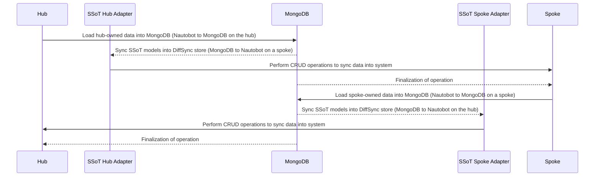

# App Overview

This document provides an overview of the App including critical information and important considerations when applying it to your Nautobot environment.

!!! note
    Throughout this documentation, the terms "app" and "plugin" will be used interchangeably.

## Description

The Nautobot SSoT MongoDB app uses a MongoDB collection as a proxy layer between two kinds of Nautobot instance,
using the [Nautobot SSoT framework](https://docs.nautobot.com/projects/ssot/en/latest/) and DiffSync:

- The **hub** is the single federated instance. It owns the global catalog every other
  instance relies on and syncs in the inventory owned by the spoke instances.
- A **spoke** is a local instance. It owns its inventory (locations, racks, devices,
  interfaces, VLANs, IP addresses and cables) and relies on the hub's catalog.

Every Nautobot object becomes one MongoDB document that carries the name and role of the instance that owns it, the
Nautobot content type, a `data` payload with the object's identifying and descriptive fields, and the versions of
Nautobot and this app that wrote it. Every object synced *in* is stamped with the **SSoT MongoDB Owner** metadata
naming the instance that published it, which is how a pull tells synced objects apart from objects an instance
created itself. The app provides two jobs whose behaviour follows the `nautobot_role` setting:

| Job | On the hub | On a spoke |
| --- | --- | --- |
| **Nautobot to MongoDB** (`DataTarget`) | Loads the hub-owned catalog into MongoDB | Loads this spoke's inventory into MongoDB |
| **MongoDB to Nautobot** (`DataSource`) | Syncs in the inventory of the selected spokes | Syncs in the hub-owned catalog |

### Object ownership

Every object type is owned by exactly one role. The assignment is an **ownership rule** per type, listed under
**Apps > MongoDB SSoT > Ownership Rules**: the owning role, whether the type is synced at all and its position in
the sync order. The rules are defined on the hub, published to MongoDB by its **Nautobot to MongoDB** job and
mirrored by every spoke before each of its sync jobs, so they cannot be edited on a spoke. Handing a type to the other
role is done with the **Transfer Ownership** job rather than by editing the rule (see
[Using the App](app_use_cases.md#change-which-role-owns-a-type)).

By default the **hub** owns the catalog, synchronized in this dependency order:

| Nautobot model | `content_type` | Identifiers |
| --- | --- | --- |
| Manufacturer | `dcim.manufacturer` | `name` |
| Platform | `dcim.platform` | `name` |
| Location Type | `dcim.locationtype` | `name` |
| Device Type | `dcim.devicetype` | `model`, `manufacturer__name` |
| Tenant Group | `tenancy.tenantgroup` | `name` |
| Tenant | `tenancy.tenant` | `name` |
| Namespace | `ipam.namespace` | `name` |
| VRF | `ipam.vrf` | `name`, `namespace__name` |
| Role | `extras.role` | `name` |
| Prefix | `ipam.prefix` | `network`, `prefix_length`, `namespace__name` |

By default each **spoke** owns its inventory:

| Nautobot model | `content_type` | Identifiers |
| --- | --- | --- |
| Location | `dcim.location` | `name`, `parent__name` |
| Rack Group | `dcim.rackgroup` | `location__name`, `name` |
| Rack | `dcim.rack` | `location__name`, `name` |
| Device | `dcim.device` | `name`, `location__name` |
| Interface | `dcim.interface` | `device__name`, `device__location__name`, `name` |
| VLAN | `ipam.vlan` | `locations__name`, `vid` |
| IP Address | `ipam.ipaddress` | `host`, `parent__namespace__name` |
| Cable | `dcim.cable` | `src_device`, `src_location`, `src_port`, `dst_device`, `dst_location`, `dst_port` |

Spoke-owned objects reference hub-owned ones by name (`location_type__name`, `device_type__model`, `role__name`,
`platform__name`, `status__name`, `tenant__name`, `parent__namespace__name`), so a spoke must mirror the hub's catalog
before it can publish, and the hub must hold the catalog before it can mirror a spoke. Devices without a name are not
synchronized because they cannot be matched between instances; cables are synchronized only when both ends terminate
on interfaces.

A pull only reconciles the objects it synced in before (those stamped with an owner among the selected instances), so
objects an instance created by hand are never deleted by a sync. When a pulled object already exists locally without
an owner, it is adopted: updated in place and stamped, rather than failing on a duplicate.

### Instance registry

Every member of the federation has a row under **Apps > MongoDB SSoT > Federated Instances**: its name and role,
when it last finished a **Nautobot to MongoDB** and a **MongoDB to Nautobot** run, the Nautobot and app versions it
runs, and how many live documents it has published per object type. Nobody creates these rows. At the end of every
successful sync job an instance writes a *heartbeat* document to its own partition in MongoDB, and every sync job, at
its start and at its end, refreshes the registry from all the heartbeats it finds, so each instance holds the same
view of the federation. An instance whose partition is purged from the collection disappears from the registry on
the next refresh.

The registry is read-only in the UI and the REST API, and it also feeds the *Nautobot instances* picker on the
**MongoDB to Nautobot** job.

Deletions are always applied last and in reverse dependency order, so that, for example, a cable is removed before
its interfaces and a device before its location. On the MongoDB side a deletion is a *soft* delete: the document
becomes a tombstone (`deleted: true`) that consumers skip, that a re-created object revives, and that MongoDB expires
after `tombstone_ttl_days`.

### Sync sequence

Each owner's objects follow the same four steps. The owner loads its objects into MongoDB, the owner's SSoT adapter
syncs the stored models into the DiffSync store on the consuming instance, CRUD operations apply the diff to that
instance, and the operation is finalized on the SSoT dashboard.

In the code, the "SSoT hub adapter" is the `HubMongoAdapter` / `HubNautobotAdapter` pair and the "SSoT spoke
adapter" is the `SpokeMongoAdapter` / `SpokeNautobotAdapter` pair; each pair only knows the models its owner owns.

## Audience (User Personas) - Who should use this App?

- Teams operating one central Nautobot (the hub) that defines reference data for several site- or
  region-level Nautobot instances (the spokes), and that want a consolidated inventory of every spoke's locations and
  devices without direct connectivity between the instances.
- Network automation engineers who need to publish Nautobot data to a MongoDB-backed application.

## Authors and Maintainers

- Network to Code, LLC

## Nautobot Features Used

- **Jobs**: the app registers the two SSoT jobs listed above under the "MongoDB SSoT" grouping. They appear on the
  Nautobot SSoT dashboard as a Data Source and a Data Target.
- **Nautobot SSoT**: sync history, diff display and logging are provided by the `nautobot-ssot` app.

### Extras

- Jobs: `MongoDB to Nautobot`, `Nautobot to MongoDB` and `Transfer Ownership`.
- Metadata: the data migration creates the **SSoT MongoDB Owner** metadata type (JSON) attached to the eighteen
  synced models. Do not rename it or detach content types from it; the pull jobs rely on it.
- Model: `OwnershipRule`, one per synced content type, with list, detail and edit views, a REST API endpoint
  (`/api/plugins/ssot-mongo/ownership-rules/`) and a GraphQL type. The data migration seeds the default rules.
- Model: `FederatedInstance`, one per instance in the federation, maintained by the sync jobs, with list and detail
  views, a read-only REST API endpoint (`/api/plugins/ssot-mongo/federated-instances/`) and a GraphQL type.
- Home page: a **MongoDB SSoT** panel with the counts of federated instances and ownership rules.
- No custom fields or relationships are added by this app.
